

Министерство Образования Российской Федерации

Пермский Государственный Национальный Исследовательский университет

Государственного и муниципального управления

# Отчет по Лабораторной работе №2

**по дисциплине:** «Язык программирования С++»

Вариант 6

> Выполнил студент гр.ИТ-5, 2 курс
>
> Ершов Р.Д.
>
> Руководитель Ракина В.Д.

г. Пермь, 2026

---

## Задание 1. Задача 4

### Текст задачи

Дан набор целых чисел с четным количеством элементов. Заполнить дек D исходными числами, вывести первую половину элементов дека D в обратном порядке, а затем — вторую половину (также в обратном порядке).

### Алгоритм решения

Сначала пользователь вводит количество элементов, которое программа проверяет на корректность: число должно быть целым, положительным и чётным. Затем пользователь вводит указанное количество целых чисел. Каждое введённое значение проверяется на корректность, после чего добавляется в вектор numbers. Если все значения введены правильно, на основе вектора создаётся двусторонняя очередь deque с теми же элементами. Далее вызывается функция Task1_4, в которую передаётся очередь. Внутри функции определяется количество элементов в одной половине очереди с помощью деления общего количества элементов на 2. Затем с помощью обратных итераторов rbegin() и rend() выводится первая половина очереди в обратном порядке, после чего аналогичным способом выводится вторая половина также в обратном порядке. В результате программа отображает обе половины исходной последовательности в обратном порядке.

### Тестирование

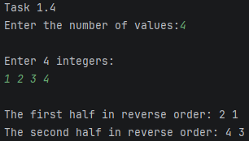

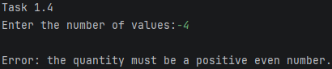

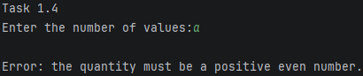

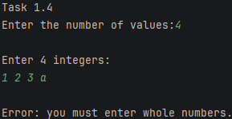

---

## Задание 2. Задача 7

### Текст задачи

Дан вектор V. Вставить после каждого элемента исходного вектора число − 1. Использовать функцию-член insert в цикле с параметром-итератором. Указание. Организуйте перебор элементов вектора в цикле с параметром-итератором i. Вставку выполняйте впозицию ++i, обязательно присваивая параметру i значение, возвращаемое функцией-членом insert.

### Алгоритм решения

Сначала пользователь вводит количество элементов вектора, которое программа проверяет на корректность: число должно быть целым и положительным. Затем пользователь вводит указанное количество целых чисел. Каждое введённое значение проверяется на корректность и добавляется в вектор numbers. Если все значения введены правильно, на основе полученных данных создаётся вектор V, который передаётся в функцию Task2_7 по ссылке. Внутри функции с помощью цикла for и итератора i выполняется перебор элементов вектора. После каждого исходного элемента с помощью функции-члена insert вставляется число -1. При этом итератор перемещается на позицию вставленного элемента, чтобы при следующем увеличении перейти к следующему исходному элементу, не обрабатывая вставленное значение повторно. После завершения вставки программа выводит на экран полученный вектор, в котором после каждого исходного элемента находится число -1.

### Тестирование

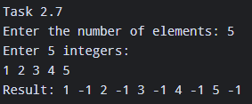

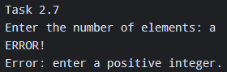

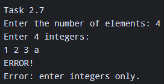

---

## Задание 3. Задача 1

### Текст задачи

Дан дек D с нечетным количеством элементов N (≥3). Удалить средний элемент дека. Использовать функцию-член erase.

### Алгоритм решения

Сначала пользователь вводит количество элементов, которое программа проверяет на корректность: число должно быть целым, нечётным и не меньше 3. Затем пользователь вводит указанное количество целых чисел. Каждое введённое значение проверяется на корректность и добавляется в вектор numbers. Если все значения введены правильно, на основе вектора создаётся двусторонняя очередь deque с теми же элементами, которая передаётся в функцию Task3_1 по ссылке. Внутри функции с помощью итератора middle определяется позиция среднего элемента очереди путём прибавления половины её размера к начальному итератору begin(). Затем с помощью функции erase удаляется средний элемент. После этого программа перебирает оставшиеся элементы очереди с помощью цикла for и выводит полученную последовательность на экран.

### Тестирование

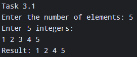

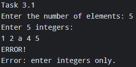

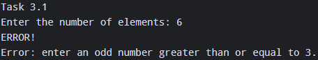

---

## Задание 4. Задача 7

### Текст задачи

Дана строка name и целое число K (\> 0). Записать в текстовый файл с именем name K символов «\*». Использовать алгоритм fill_n.

### Алгоритм решения

Сначала пользователь вводит имя файла и количество символов K, которое программа проверяет на корректность: число должно быть целым и положительным. Для считывания числа используется istream_iterator. Если значение введено правильно, вызывается функция Task4_7, которой передаются имя файла и количество символов. Внутри функции с помощью ofstream создаётся файл с указанным именем и проверяется успешность его открытия. Если файл удалось открыть, с помощью алгоритма fill_n и итератора ostream_iterator в файл записывается K символов \*. После записи файл закрывается, а функция возвращает значение true. Если открыть файл не удалось, функция возвращает false. В зависимости от результата работы функции программа выводит сообщение об успешном создании файла или об ошибке его открытия.

### Тестирование

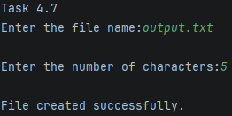

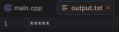

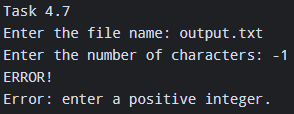

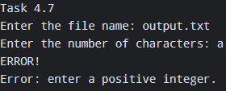

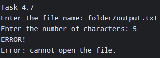

(если попробовать создать файл в несуществующей папке)

---

## Задание 5. Задача 6

### Текст задачи

Даны вектор V и список L; вектор V имеет четное количество элементов. Продублировать последний элемент списка, совпадающий с каким-либо элементом из первой половины исходного вектора. Если список не содержит требуемых элементов, то не изменять его. Использовать алгоритм find_first_of и функцию-член insert для списка.

### Алгоритм решения

Сначала пользователь вводит размер вектора, который программа проверяет на корректность: число должно быть положительным и чётным. Затем пользователь вводит указанное количество целых чисел, которые добавляются в вектор vector_values. После этого пользователь вводит размер списка, который должен быть неотрицательным числом, и заполняет его целыми числами. Если все данные введены правильно, вызывается функция Task5_6, которой передаются вектор и список. Внутри функции с помощью итератора half_end определяется конец первой половины вектора. Затем алгоритм find_first_of выполняет поиск первого совпадения между элементами списка, перебираемыми в обратном порядке, и элементами первой половины вектора. Если совпадение не найдено, функция завершает работу без изменений списка. Если совпадение найдено, с помощью base() и prev() определяется позиция найденного элемента в обычном порядке, после чего перед ним вставляется его копия. По завершении работы функции программа выводит полученный список на экран.

### Тестирование

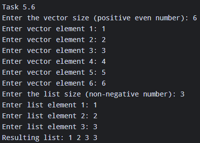

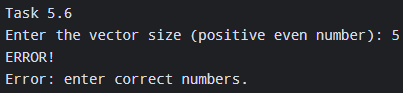

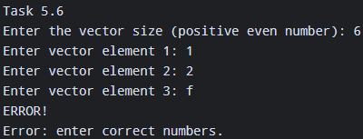

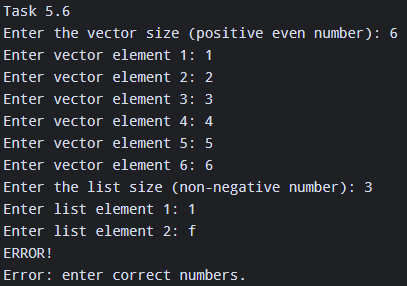

---

## Задание 6. Задача 6

### Текст задачи

Дано число K (0 \<K\< 10) и списки L1 и L2, каждый из которых содержит не менее 10 элементов. Выполнить для списка L1 циклический сдвиг элементов вправо на K позиций, а для списка L2 — циклический сдвиг влево на K позиций. Использовать алгоритм rotate и функцию advance.

### Алгоритм решения

Сначала пользователь вводит число K, которое программа проверяет на корректность: оно должно быть целым и находиться в диапазоне от 1 до 9. Затем пользователь вводит размер первого списка, который должен содержать не менее 10 элементов, и заполняет его целыми числами. Аналогичным образом вводится размер и элементы второго списка. Если все данные введены правильно, вызывается функция Task6_6, которой передаются оба списка и значение K. Внутри функции с помощью итератора right_middle определяется позиция элемента первого списка, начиная с которого выполняется циклический сдвиг вправо на K позиций. Для этого используется алгоритм rotate. Затем с помощью итератора left_middle определяется позиция элемента второго списка, начиная с которого выполняется циклический сдвиг влево на K позиций. Аналогично применяется алгоритм rotate. После завершения сдвигов программа выводит оба изменённых списка на экран.

### Тестирование

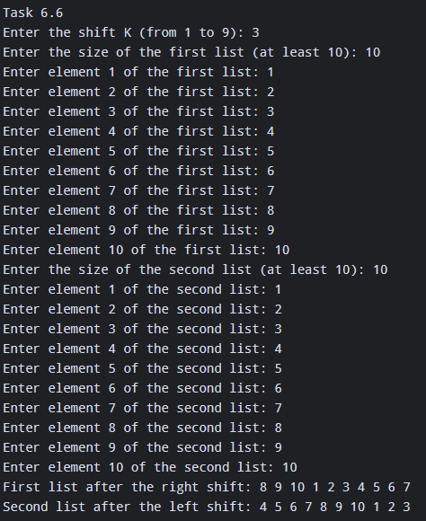

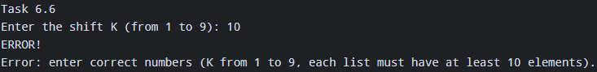

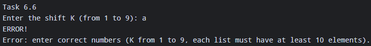

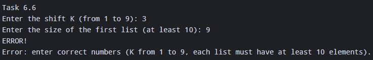

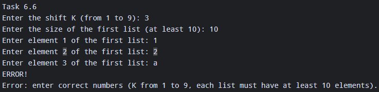

---

## Задание 7. Задача 3

### Текст задачи

Дан вектор V, содержащий не менее 3 элементов. Определить значения трех конечных элементов вектора после того, как вектор будет отсортирован (по возрастанию) и вывести их в порядке убывания. Использовать один вызов алгоритма partial_sort с параметром — функциональным объектом greater и алгоритм copy для вывода требуемых элементов.

### Алгоритм решения

Сначала пользователь вводит размер вектора, который программа проверяет на корректность: число должно быть целым и не меньше 3. Затем пользователь вводит указанное количество целых чисел, которые добавляются в вектор vector_values. Если все данные введены правильно, вызывается функция Task7_3, которой передаётся вектор по ссылке. Внутри функции с помощью алгоритма partial_sort выполняется частичная сортировка элементов вектора по убыванию с использованием компаратора greater\<int\>. При этом сортируются только три наибольших элемента, которые размещаются в начале вектора. После завершения сортировки программа с помощью алгоритма copy и итератора ostream_iterator выводит первые три элемента вектора на экран в порядке убывания.

### Тестирование

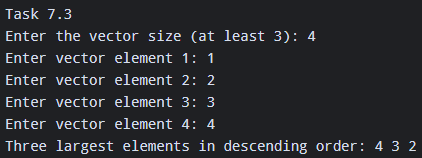

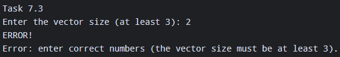

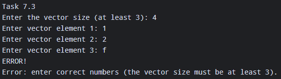

---

## Задание 8. Задача 1

### Текст задачи

Дан список L. Получить вектор V вещественных чисел, содержащий значения среднего арифметического для всех пар соседних элементов исходного списка (количество элементов вектора V должно быть на 1 меньше количества элементов списка L). Например, для исходного списка 1, 3, 4, 6 полученный вектор должен содержать значения 2.0, 3.5, 5.0. Использовать алгоритм adjacent_difference с итератором вставки и функциональным объектом, а также функцию-член erase для вектора V.

### Алгоритм решения

Сначала пользователь вводит размер списка, который программа проверяет на корректность: число должно быть целым и не меньше 2. Затем пользователь вводит указанное количество целых чисел, которые добавляются в список list_values. Если все данные введены правильно, вызывается функция Task8_1, которой передаётся список. Внутри функции создаётся пустой вектор averages, после чего с помощью алгоритма adjacent_difference и функционального объекта AverageOfPair вычисляются средние арифметические значения каждой пары соседних элементов списка. Функциональный объект AverageOfPair перегружает оператор () и возвращает сумму двух соседних элементов, разделённую на 2.0, благодаря чему результат сохраняется в виде вещественного числа. Поскольку алгоритм adjacent_difference сначала записывает первый элемент исходного списка без изменений, он удаляется с помощью erase. После этого функция возвращает вектор со средними значениями соседних пар. В основной программе с помощью fixed и setprecision(1) устанавливается вывод одного знака после запятой, после чего все полученные значения выводятся на экран.

### Тестирование

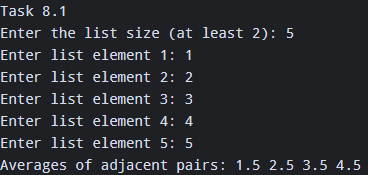

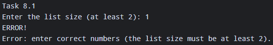

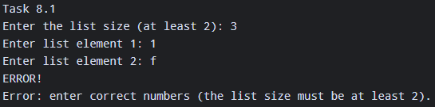

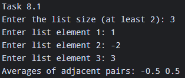

---

## Задание 9. Задача 1

### Текст задачи

Дан вектор V0, целое число N (\> 0) и набор векторов V1, …, VN. Известно, что размер вектора V0 не превосходит размера любого из векторов V1, …, VN. Найти количество векторов VI, I = 1, …, N, в которых содержатся все элементы вектора V0 (без учета их повторений). Использовать алгоритм includes, применяя его в цикле к двум множествам, одно из которых создано на основе вектора V0, а другое на очередной итерации содержит элементы очередного из векторов VI, I = 1, …, N.

### Алгоритм решения

Сначала пользователь вводит размер базового вектора V0, который программа проверяет на корректность: число должно быть целым и положительным. Затем пользователь вводит элементы этого вектора. После этого вводится количество дополнительных векторов N, которое также должно быть положительным целым числом. Далее пользователь поочерёдно вводит размеры дополнительных векторов и их элементы. Размер каждого дополнительного вектора должен быть не меньше размера базового вектора. Если все данные введены правильно, вызывается функция Task9_1, которой передаются базовый вектор и набор дополнительных векторов. Внутри функции из элементов базового вектора создаётся множество base_set, а затем для каждого дополнительного вектора создаётся отдельное множество current_set. Преобразование в множества позволяет автоматически упорядочить элементы и исключить повторяющиеся значения. С помощью алгоритма includes проверяется, содержит ли текущее множество все элементы базового множества. Если условие выполняется, счётчик matching_count увеличивается на единицу. После проверки всех векторов функция возвращает количество множеств, содержащих все элементы базового множества. В основной программе полученное значение выводится на экран.

### Тестирование

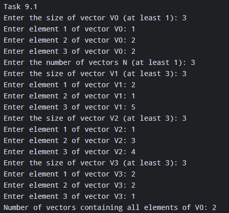

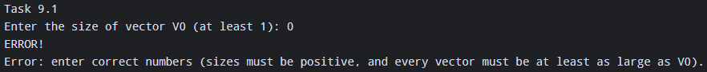

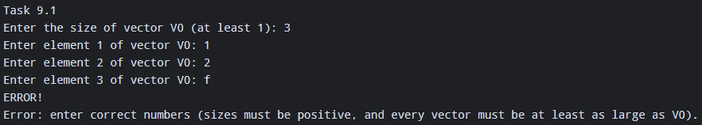

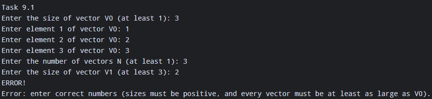

(базовый вектор не должен превышать размер вектора VN)

---

## Задание 10. Задача 2

### Текст задачи

Дан вектор V, элементами которого являются английские слова, набранные заглавными буквами. Определить суммарную длину слов, начинающихся с одной и той же буквы, и вывести все различные буквы, с которых начинаются элементы вектора V, вместе с суммарной длиной этих элементов (в алфавитном порядке букв); длину выводить сразу после соответствующей буквы. Использовать вспомогательное отображение M, ключами которого являются начальные буквы элементов вектора V, а значениями — суммарная длина этих элементов. При заполнении отображения M не использовать условные конструкции (достаточно операций индексирования \[\], инкремента и функции-члена size для строк). Элементы вектора V (при заполнении отображения M) и элементы отображения M (при выводе полученных результатов) перебирать в цикле с параметром-итератором соответствующего контейнера.

### Алгоритм решения

Сначала пользователь вводит количество слов, которое программа проверяет на корректность: число должно быть целым и положительным. Затем пользователь вводит указанное количество слов, состоящих только из заглавных букв английского алфавита. Проверка выполняется с помощью алгоритма all_of и лямбда-выражения, которое проверяет, что каждая буква находится в диапазоне от A до Z. Если все данные введены правильно, вызывается функция Task10_2, которой передаётся вектор words. Внутри функции создаётся пустая ассоциативная таблица map, в которой ключом является первая буква слова, а значением — суммарная длина всех слов, начинающихся с этой буквы. С помощью итератора выполняется перебор всех слов вектора. Для каждого слова определяется его первая буква и длина, после чего длина прибавляется к соответствующему значению в map. Если несколько слов начинаются с одной буквы, их длины суммируются. После завершения обработки функция возвращает полученную ассоциативную таблицу. В основной программе с помощью итератора выполняется перебор элементов map, и для каждой буквы выводятся её значение и общая длина соответствующих слов.

### Тестирование

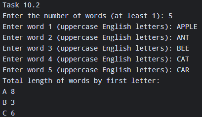

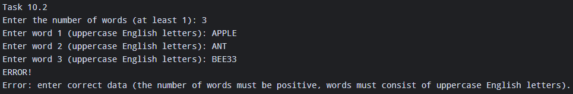

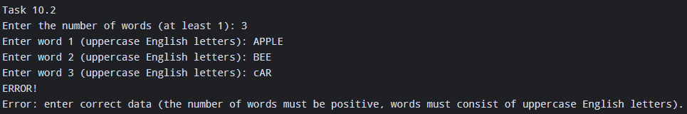

